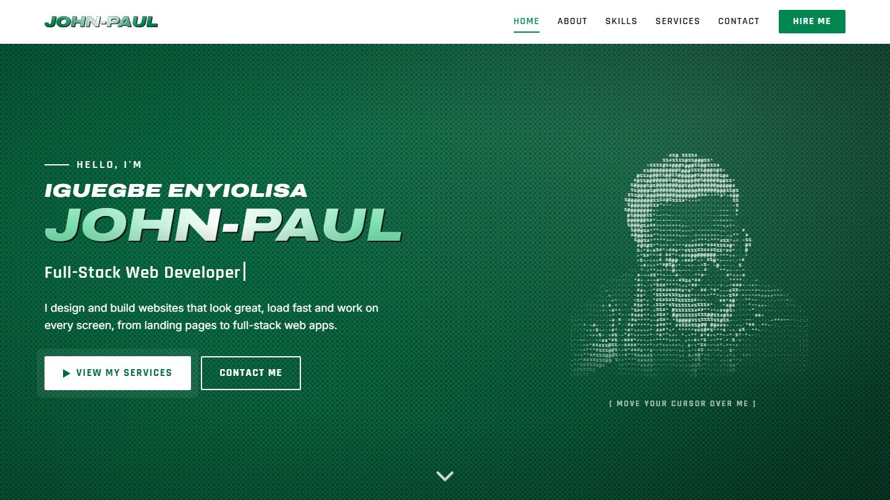

# Iguegbe Enyiolisa John-Paul · Portfolio

My personal site as a full-stack web developer. It's a one-page portfolio with a
gaming-HUD look, AMG-inspired details and Nigeria's green-white-green running
from top to bottom.

**Live site: [iguegbe.netlify.app](https://iguegbe.netlify.app)**

## What's on the page

- **Hero:** my name in an AMG-style chrome wordmark, a typing effect, and a
  portrait made of ASCII characters that fly in, assemble and scatter away from
  your cursor or finger.
- **Skills:** laid out like a game loadout, with a primary (frontend), a
  secondary (backend), equipment (tools) and perks.
- **Services:** four "missions" a client can pick. Picking one pre-fills the
  WhatsApp and email message in the Contact section.
- **Off the clock:** photos of what I'm into, which fly in from all directions
  and snap into a grid as you scroll.
- **FAQ:** answers to common client questions about timelines, revisions,
  hosting and support.
- **Contact:** WhatsApp, email (with copy and Gmail options) and my socials.

Animations run as you scroll and switch off for anyone who turns on "reduce
motion" on their device. The layout is built mobile-first.

## Built with

- HTML, CSS and JavaScript, with no frameworks
- Bootstrap 5.3 for the grid and navbar
- Hosted on Netlify

There's no build step. Open `index.html` in a browser, or serve the folder with
any static server.

## Get in touch

- WhatsApp: [+234 814 677 6126](https://wa.me/2348146776126)
- Email: [ienyiolisa@gmail.com](mailto:ienyiolisa@gmail.com)
- X: [@Chikeleze1](https://x.com/Chikeleze1)
